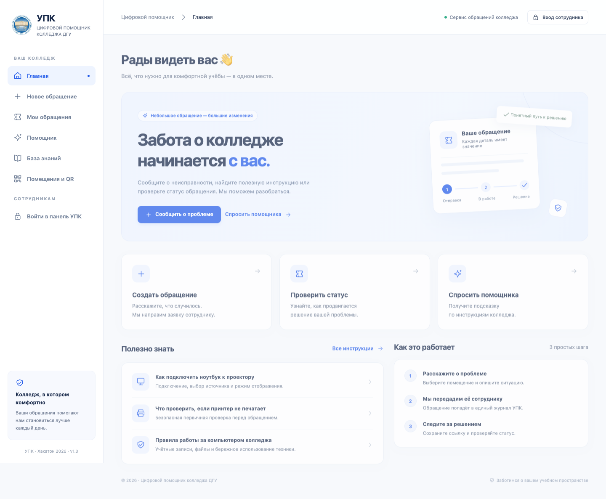

# УПК — цифровой помощник колледжа ДГУ

Веб-приложение по кейсу «УПК: Цифровой помощник колледжа». Заявитель сообщает о проблеме по QR-коду, получает безопасную ссылку и следит за решением. Сотрудник назначает исполнителя, общается с заявителем и фиксирует результат.

**Белый и синий интерфейс, логотип ДГУ, адаптация для телефона. Python + Flask + SQLite. Node.js, облачная база и ключ ИИ для запуска не нужны.**



## Проверяющему: быстрый запуск

Требуется Python 3.10 или новее. Интернет нужен только для установки зависимостей. После установки основной функционал работает локально.

### macOS / Linux

Откройте терминал в папке проекта:

```bash
python3 -m venv .venv
.venv/bin/python -m pip install -r requirements.txt
.venv/bin/python app.py
```

### Windows PowerShell

```powershell
py -3 -m venv .venv
.venv\Scripts\python.exe -m pip install -r requirements.txt
.venv\Scripts\python.exe app.py
```

Откройте **http://localhost:8000**. База, справочники, 10 демонстрационных заявок и аккаунты создаются автоматически. Остановить сервер: `Ctrl+C`. Повторный запуск сохраняет данные.

### Проверка прямо из GitHub

Репозиторий содержит конфигурацию **GitHub Codespaces**. Если Codespaces доступен вашему аккаунту, откройте `Code → Codespaces → Create codespace on main`. Дождитесь установки зависимостей и выполните в его терминале:

```bash
.venv/bin/python app.py
```

Откройте порт **8000** во вкладке **Ports**. Это личная среда проверки, отдельный хостинг для приложения не нужен. Не меняйте видимость порта на публичную для обычной проверки. Если встроенный предпросмотр не сохраняет вход, откройте адрес порта в отдельной вкладке браузера.

GitHub Pages не запускает Python и SQLite. Нельзя проверять приложение простым открытием `index.html`: нужен сервер по одному из способов выше. Конфигурация Codespaces подготовлена, но сама облачная среда в этом проекте не запускалась.

## Учётные записи

| Логин | Роль | Возможности |
| --- | --- | --- |
| `admin` | Администратор | Все заявки, аналитика, QR, пользователи, роли, категории, назначения |
| `staff` | Сотрудник УПК | Работа с заявками, комментариями, статусами и отчётами |
| `technician` | Сотрудник УПК | Вторая учётная запись исполнителя |
| Без входа | Заявитель | Создание, инструкция, доступ к своей заявке по секретной ссылке |

**Уникальные пароли выводятся при первом запуске** и сохраняются локально в `.data/demo-accounts.txt`. Общих паролей в исходниках нет. Для изменения пароля используйте панель администратора. Файл первоначальных паролей автоматически не обновляется после смены пароля в панели.

Заявитель не имеет доступа к списку чужих обращений. Сотрудники УПК в этой версии работают с общим журналом. `technician` не является отдельной ограниченной ролью исполнителя.

## Что реализовано

- Мобильная форма с ручным выбором помещения и подстановкой по QR.
- Реальная SQLite-база, уникальные номера, защита от повторного нажатия и параллельной отправки с одним ключом.
- Секретные ссылки отслеживания, публичные комментарии, история статусов, ответы заявителя.
- Фотографии JPEG/PNG/WebP до 5 МБ с проверкой содержимого, удалением метаданных при перекодировании и защищённым доступом.
- Авторизация, серверное разграничение доступа, роли администратора и сотрудника.
- Поиск по номеру и тексту без учёта регистра, фильтры по статусу, категории, помещению и датам, пагинация.
- Все семь статусов кейса, исполнитель, приоритет, итоговый комментарий, внутренние заметки.
- Семь инструкций, включая четыре раздела предоставленного документа.
- Демонстрационный помощник: типовой вопрос, неисправность, опасность, уточнение, неизвестный запрос.
- Пять помещений, реальные QR-коды, скачивание PNG, печать, изменение QR-привязок.
- Количество заявок, открытые и решённые, категории, помещения, динамика, среднее время решения и оценки.
- Управление аккаунтами, их ролями и активностью, справочником категорий, автоматической маршрутизацией и журналом административных действий.

### Дополнительные функции

| Функция из кейса | Реализация |
| --- | --- |
| Email / Telegram | Очередь, согласие заявителя, демонстрационный журнал. Реальные SMTP и Telegram-адаптеры запускаются отдельно после настройки |
| Похожие обращения | Предупреждение по совпадению помещения и категории среди открытых заявок. Чужие описания не раскрываются |
| Предложение приоритета | Правила классификации, срочный приоритет для опасных признаков, сотрудник может изменить |
| Распознавание фото | Честный деморежим без распознавания. Подготовлен серверный адаптер для модели с поддержкой изображений, включаемый ключом |
| Автоматическое назначение | Исполнитель категории назначается при создании, настройки меняет администратор |
| Экспорт | CSV, открывается в Excel, UTF-8 BOM, защита ячеек от формул, учитывает фильтры |
| Оценка удовлетворённости | От 1 до 5 и комментарий по секретной ссылке после решения |
| Карта помещений | Условная схема с фильтром этажей и количеством открытых обращений для сотрудников |
| Повторяющиеся проблемы | Аналитика повторов по сочетанию категории и помещения |

## Проверка за пять минут

1. Откройте `http://localhost:8000/#/new?location=room-214`.
2. Введите «В кабинете 214 не работает проектор». Нажмите «Подсказать категорию».
3. Отправьте заявку и сохраните секретную ссылку.
4. Войдите как `admin` или `staff` с паролем из терминала.
5. Найдите номер во «Всех заявках», назначьте исполнителя, выберите «В работе» и сохраните.
6. Выберите «Решена», заполните результат и сохраните.
7. Откройте сохранённую ссылку в другом браузере или после выхода. Проверьте результат и оставьте оценку.
8. В помощнике проверьте «Как подключить ноутбук к проектору?», «В розетке искрит» и «Когда починят проектор?».

Подробный сценарий, критерии AT-01–AT-12 и тестовые запросы: [docs/ACCEPTANCE.md](docs/ACCEPTANCE.md).

## Демонстрационный ИИ

Помощник **не является языковой моделью**. Он использует правила на русском языке и подготовленную базу знаний. Это явно обозначено в интерфейсе. Он не создаёт заявки без подтверждения, не меняет статусы, не придумывает контакты или сроки. Неизвестные вопросы передаёт человеку.

В деморежиме фото сохраняется для сотрудника, а содержание не распознаётся. Реальные запросы к модели и отправка уведомлений по умолчанию отключены и не требуются для защиты проекта.

Подключение интеграций и ограничения: [docs/INTEGRATIONS.md](docs/INTEGRATIONS.md), [docs/LIMITATIONS.md](docs/LIMITATIONS.md).

## QR-коды и телефон

Пять готовых PNG для локального запуска находятся в [docs/qr](docs/qr). Они ведут на `localhost:8000` и предназначены для проверки на компьютере. Для сканирования телефоном:

1. Подключите телефон и компьютер к одной сети.
2. Скопируйте `.env.example` в `.env`.
3. Установите `HOST=0.0.0.0` и `PUBLIC_BASE_URL=http://IP-КОМПЬЮТЕРА:8000`.
4. Перезапустите сервер. Скачайте или распечатайте обновлённые QR из раздела «Помещения и QR».
5. Разрешите локальное сетевое подключение в брандмауэре при необходимости.

На телефоне `localhost` означает сам телефон. Готовые локальные PNG для телефона не подходят. Для Codespaces адрес QR автоматически берётся из переменных среды, если `PUBLIC_BASE_URL` не задан вручную. Для сканирования приватного адреса Codespaces нужен доступ к этой среде.

## Проверки

```bash
.venv/bin/python -m unittest discover -s tests -v
```

Проверяются сценарии кейса, хранение, доступ, приватность, вложения, обновление истории, запрет автоматического закрытия, оценки и деморежим интеграций. GitHub Actions выполняет тесты на Python 3.10 и 3.12.

Необязательная проверка интерфейса:

```bash
.venv/bin/python -m pip install -r requirements-dev.txt
.venv/bin/python -m playwright install chromium
.venv/bin/python scripts/browser_check.py
```

На macOS скрипт использует установленный Google Chrome, если он найден. Иной путь можно задать в `CHROME_EXECUTABLE`. Скрипт использует временную базу, проверяет полный процесс и делает снимки в `docs/screenshots`. На Windows замените `.venv/bin/python` на `.venv\Scripts\python.exe`.

## Структура проекта

```text
app.py                      HTTP API, доступ, заявки, фото, QR, отчёты
assistant.py                Демоклассификатор и база знаний
integrations.py             Необязательные внешние адаптеры
schema.sql                  Схема SQLite
db.py                      Инициализация и демонстрационные данные
static/                     Интерфейс без сборки, стили и логотип
scripts/send_notifications.py  Обработчик очереди уведомлений
scripts/browser_check.py    Сквозная проверка в браузере
scripts/export_qr.py        Генерация набора QR-кодов
tests/                     Серверные проверки
docs/                      Архитектура, приёмка, защита, ограничения
.data/                      Локальные данные и пароли, исключены из Git
```

Архитектура и схема связей: [docs/ARCHITECTURE.md](docs/ARCHITECTURE.md). Материалы короткой презентации: [docs/PRESENTATION.md](docs/PRESENTATION.md).

## Загрузка в GitHub

Создайте пустой репозиторий и загрузите исходники, `static`, `docs`, `tests`, `scripts`, `.devcontainer`, `.github`, `.env.example` и `.gitignore`. При работе через Git:

```bash
git init
git add .
git status
git commit -m "Add college service desk application"
git branch -M main
git remote add origin https://github.com/YOUR_ACCOUNT/YOUR_REPOSITORY.git
git push -u origin main
```

Перед коммитом убедитесь, что `.data`, `.env` и `.venv` отсутствуют в списке добавленных файлов. `.gitignore` исключает их автоматически. При ручной загрузке через браузер исключайте эти папки самостоятельно. Не загружайте архив всей рабочей папки: он может содержать локальные пароли и базу.

`package.json` оставлен для удобства IDE: `npm run dev` вызывает Python из `.venv` на macOS/Linux. `npm install` и `npm run build` не нужны. Основной и переносимый способ запуска описан выше.
