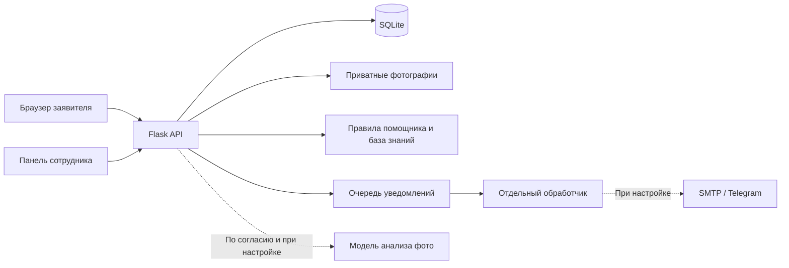
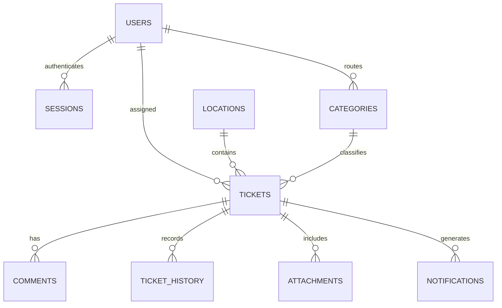

# Архитектура и данные

## Поток запроса

Интерфейс — HTML, CSS и JavaScript без сборки и внешних CDN. Приложение и API используют один origin. Маршруты экрана находятся после `#`, поэтому работают при прямом открытии ссылки без дополнительной настройки сервера.

Flask обрабатывает HTTP. SQLite использует внешние ключи, режим WAL и транзакции. Соединение создаётся на запрос и закрывается после него. При ошибке незавершённая транзакция откатывается.

## Модели

| Таблица | Назначение и важные поля |
| --- | --- |
| `users` | Имя, логин, scrypt-хеш пароля, роль `admin` / `staff`, активность |
| `sessions` | Хеш случайного токена сессии, пользователь, срок действия 8 часов |
| `tickets` | Номер, тема, описание, категория, место, статус, приоритет, даты, исполнитель, хеш токена отслеживания, хеш ключа отправки, контакты, оценка, версия записи |
| `categories` | Ключ, название, значок, исполнитель по умолчанию |
| `locations` | Корпус, этаж, кабинет/зона, назначение и уникальный QR-ключ |
| `comments` | Текст, автор, дата, видимость `public` / `internal` |
| `ticket_history` | Событие, автор, дата, старый/новый статус и пояснение |
| `attachments` | Случайный идентификатор, приватный путь, MIME, размер и дата |
| `notifications` | Канал, адресат, текст, состояние доставки и даты |
| `ai_runs` | Тип и категория ответа помощника, дата. Исходные сообщения отдельно не сохраняются |
| `audit_log` | Управление аккаунтами, ролями, категориями и помещениями |

База знаний хранится в `assistant.py` как проверяемые версионируемые записи с источниками. В ней семь инструкций. Структура соответствует модели KnowledgeBase, отдельная таблица для неизменяемого справочника не требуется.

Точные типы, ограничения и индексы находятся в [schema.sql](../schema.sql). Поля `locations.x/y` зарезервированы, визуальная схема в этой версии автоматически раскладывает помещения по выбранному этажу.

## Доступ

- Заявитель создаёт обращение без аккаунта. Полный журнал ему недоступен.
- Секретный код формируется через HMAC-SHA256 от случайного 256-битного ключа отправки и серверного секрета. В базе хранится SHA256-хеш кода.
- Токен отслеживания находится во фрагменте ссылки, не в URL HTTP-запроса. Браузер передаёт его в `X-Tracking-Token`.
- Перебор публичных номеров не даёт доступа к заявкам. Ошибки доступа к чужому объекту возвращают 404.
- Фото выдаётся только после проверки сессии сотрудника или токена именно его заявки.
- Приватные заметки и контакты не входят в публичный JSON. Общественное предупреждение о похожих проблемах содержит только агрегированное количество.
- Сотрудник видит все заявки УПК. Административные операции требуют роли `admin` на сервере.
- Оценка требует токен заявителя даже при наличии сессии администратора.
- Сессия хранится в HttpOnly cookie, SameSite=Strict, истекает через 8 часов. Выход и изменения учётной записи отзывают сессии.
- Все изменяющие API-запросы требуют специальный заголовок, origin проверяется, CORS не включён. При HTTPS включается Secure cookie.
- Пароли не встраиваются в исходники. У каждой установки свои случайные пароли, а рабочая база содержит только хеши. Первоначальные пароли остаются в локальном файле для демонстрации.

## Целостность процесса

Одной отправке соответствует случайный `request_key`. Транзакция `BEGIN IMMEDIATE` повторно проверяет ключ перед вставкой, поэтому одновременные повторы возвращают ту же заявку и ссылку. Новый ключ означает новую отправку. Предупреждение о похожих обращениях не блокирует сообщение о другой проблеме.

Сотрудник отправляет версию записи. Если другой сотрудник уже изменил её, сервер возвращает 409 вместо потери изменений. Допустимые переходы перечислены в `db.TRANSITIONS`. Из «Новая» нельзя сразу перейти в «Решена». Для «Назначен исполнитель» и «В работе» нужен действующий исполнитель. Решение и отклонение требуют итогового публичного комментария. Повторное открытие снимает дату решения и прежнюю оценку.

Обновление заявки, история и постановка уведомлений выполняются в одной транзакции. Помощник не имеет операций изменения статусов.

## Фотографии

Сервер ограничивает тело запроса и размер файла, распознаёт фактическое содержимое через Pillow, ограничивает число пикселей, перекодирует JPEG/PNG/WebP в JPEG, убирая EXIF и встроенные данные, уменьшает до 1920×1920. Исходное имя не используется как путь. Папка загрузок находится вне `static`.

## Аналитика

Среднее время до решения вычисляется только для текущих решённых заявок по разности `resolved_at` и `created_at`. Решения без корректной даты не подменяются нулём. Распределения и оценки рассчитываются из базы. Группировка динамики использует даты UTC, а карточки показывают время браузера. Повторяемость означает совпадение категории и помещения, а не доказанную идентичность неисправности.

## Локальное хранение и развёртывание

База, вложения, серверный секрет и первоначальные пароли находятся в `.data/`, исключённой из Git. В браузере сохраняются только собственные ссылки и краткие сведения о своих отправках. Удаление ссылки с устройства не удаляет заявку.

Хакатонная версия запускается одним процессом Flask. Для публичного промышленного внедрения требуются производственный WSGI-сервер, HTTPS, резервное копирование, политика хранения данных и лимиты на дисковое пространство. Счётчики ограничения запросов сейчас находятся в памяти одного процесса.
