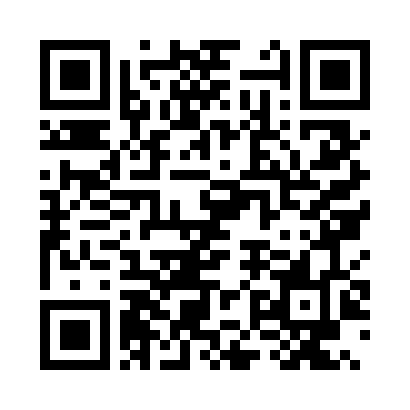
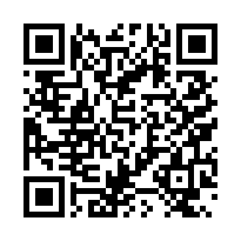

# Демонстрационные QR-коды

Адрес приложения: `http://localhost:8000`.

Для смартфона используйте доступный ему сетевой адрес и пересоздайте набор. Коды содержат только ключ помещения, без персональных данных.

## 214 — Учебная аудитория

[Открыть форму](http://localhost:8000/#/new?location=room-214)

## 305 — Компьютерная лаборатория

[Открыть форму](http://localhost:8000/#/new?location=lab-305)

## Холл — Общая зона

[Открыть форму](http://localhost:8000/#/new?location=hall-1)

## 208 — Библиотека

[Открыть форму](http://localhost:8000/#/new?location=library-208)

## 112 — Учебная аудитория

[Открыть форму](http://localhost:8000/#/new?location=room-112)
